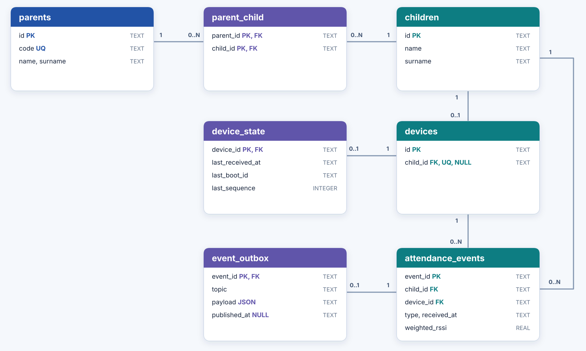
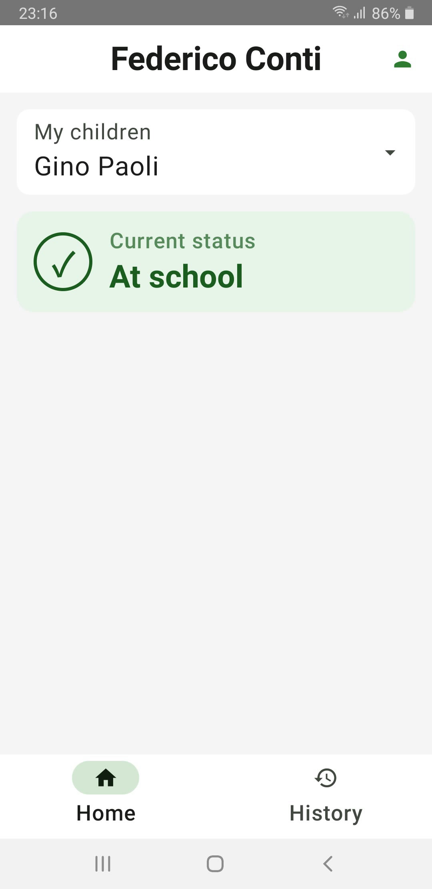
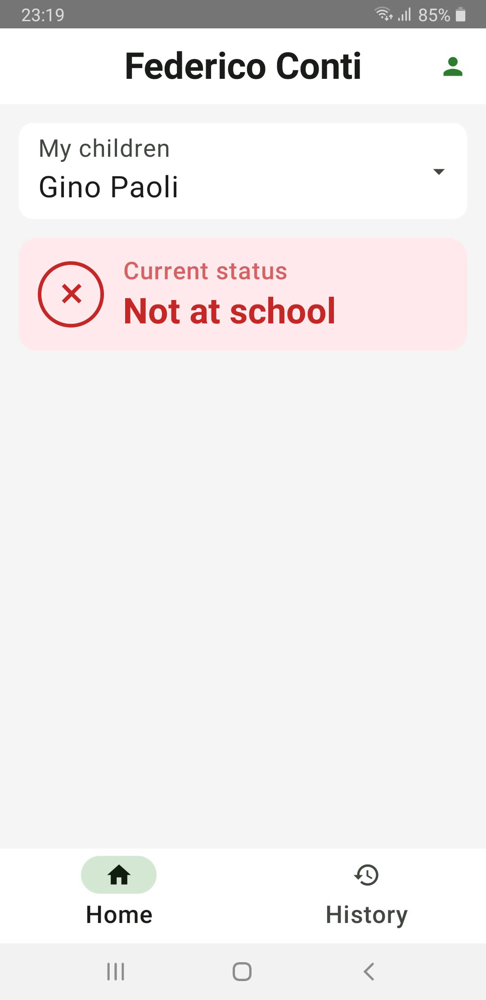
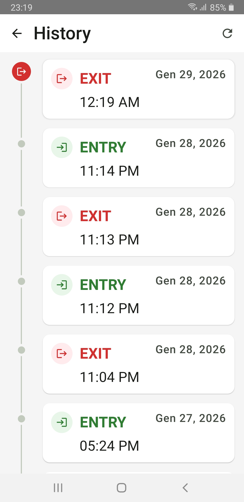

<picture>
  
</picture>

# 🎒ClassMate

ClassMate è un prototipo dimostrativo per rilevare l'ingresso e l'uscita dei bambini da scuola tramite un dispositivo IoT indossabile simulato.
Il dispositivo genera valori sintetici di potenza del segnale Wi-Fi (RSSI), usati come indicatore di prossimità. Il sistema li elabora per registrare gli eventi di ingresso e uscita.
I genitori possono consultare lo stato e la cronologia degli eventi nell'app Android ["ParentApp"](https://github.com/Federico-Conti/classmate/tree/iot), per sapere quando il bambino entra o esce.

## 🚀 Quick Start

Prerequisiti: Docker Compose, PlatformIO, VS Code con estensione Wokwi e Android Studio. 

1. **Configurare host e credenziali.** Impostare l'IPv4 LAN del PC in `POC_BIND_ADDRESS` (`infra/config/defaults.env`) e in `mqttHost` (`firmware/include/wokwi_config.h`). Creare i tre file di password MQTT a partire dagli `.example` in `infra/secrets/`, sostituendo i contenuti con password distinte. Copiare `firmware/include/secrets.example.h` in `firmware/include/secrets.h` e impostare `device_secrets::mqttPassword` alla stessa password di `infra/secrets/mqtt_wearable_password`. 

2. **Avviare Compose e inizializzare il database.** Il provisioning usa `database/poc.example.json` (codice genitore dimostrativo `abcd`) e va eseguito su un database vuoto:

   ```sh
   ./infra/scripts/up.sh
   ./infra/scripts/database.sh provision
   ```

3. **Selezionare il profilo da simulare e compilare il wearable.** Impostare `syntheticProfile` in `firmware/include/wokwi_config.h` (predefinito `entry-exit`; [profili disponibili](#wokwi-esp32)), quindi:

   ```sh
   cd firmware
   pio run -e wokwi
   ```

4. **Avviare la simulazione Wokwi.** Aprire la cartella `firmware/` in VS Code e avviare la simulazione del dispoitivo.

5. **Avviare ParentApp su Android.** Aprire `ParentApp` in Android Studio. Nelle proprietà Gradle **utente** (`~/.gradle/gradle.properties`, non nel repository) impostare `pocHost` all'IPv4 LAN del PC, `pocMqttUsername=parent-poc` e `pocMqttPassword` alla password di `infra/secrets/mqtt_parent_password`. Compilare e avviare l'app su dispositivo o emulatore, poi loggarsi con il codice del seed (`parent`).

**Nota:** PC con Compose, simulatore Wokwie dispositivo Android devono potersi raggiungere sulla stessa LAN.

## Architettura


Il flusso parte dal wearable simulato e arriva all'app dei genitori attraverso il broker MQTT. Ogni componente ha un ruolo distinto:

- **Wokwi ESP32 (`firmware/`)**: simula il dispositivo indossabile, produce campioni RSSI sintetici e pubblica la telemetria MQTT del proprio dispositivo.
- **Mosquitto (`infra/`)**: è il broker MQTT; riceve la telemetria dall'ESP32 e la consegna a Node-RED, poi distribuisce gli eventi confermati a ParentApp. Le ACL limitano pubblicazione e sottoscrizione ai topic consentiti.
- **Node-RED (`nodered/`)**: si sottoscrive alla telemetria, valida i messaggi, verifica l'associazione dispositivo-bambino e scarta sequenze duplicate. Calcola una [media RSSI pesata](#media-pesata), classifica la presenza e conferma le transizioni stabili; salva i nuovi eventi con l'outbox e li pubblica via MQTT con retry. Espone inoltre le API HTTP per codice genitore, elenco bambini e cronologia.
- **SQLite (`database/`)**: conserva associazioni, stato dei dispositivi, eventi di ingresso/uscita e outbox per la pubblicazione affidabile. La cronologia è letta dalle API di Node-RED.
- **ParentApp**: risolve il codice genitore e consulta la cronologia tramite HTTP; si sottoscrive via MQTT agli eventi del bambino selezionato per mostrare lo stato corrente, senza pubblicare messaggi.


## Wokwi ESP32

L'ESP32 simulato in Wokwi rappresenta il dispositivo indossabile: genera campioni RSSI sintetici e, come **publisher MQTT**, invia la telemetria al broker Mosquitto. Il firmware è scritto in C++ con PlatformIO; la connessione Wi-Fi `Wokwi-GUEST` usa Wokwi Private IoT Gateway per raggiungere il broker sul PC.

<p align="center">
  
</p>

Per scegliere uno scenario, modificare `syntheticProfile` in `firmware/include/wokwi_config.h`, compilare con `pio run -e wokwi` dalla cartella `firmware/` e riavviare la simulazione. Il firmware genera un campione ogni secondo: per cambiare l'intervallo, modificare `SampleSchedule::periodMs` (in millisecondi, predefinito `1000`) in `firmware/include/sample_schedule.h`, poi ricompilare e riavviare la simulazione. I profili disponibili sono:

| Profilo | Campioni / comportamento |
| --- | --- |
| `outside` | `-90, -88, -91, -89` dBm in ciclo; segnale debole |
| `inside` | `-42, -40, -43, -41` dBm in ciclo; tutti sopra la soglia |
| `entry-exit` (default) | 30 campioni `inside`, poi 30 `outside`, in ciclo|
| `target-not-observed` | `targetObserved:false` e `rssiDbm:null` a ogni intervallo; il mancato rilevamento non genera un'uscita |
| `interruption` | Tre campioni a `-55` dBm, poi nessuna pubblicazione e LED rosso; il silenzio non genera un'uscita |

Per esempio, sul topic `classmate/v1/devices/esp32-001/telemetry` pubblica un payload JSON come questo (dove il `bootId` varia a ogni esecuzione):

```json
{"schemaVersion":1,"deviceId":"esp32-001","bootId":"8b210baef3b139ac","sequence":2,"deviceUptimeMs":12805,"wifi":{"targetObserved":true,"rssiDbm":-91}}
```

## MQTT broker

Il broker è **Eclipse Mosquitto**, avviato come servizio `mosquitto` da `infra/compose.yaml` tramite `./infra/scripts/up.sh`. Ascolta sulla porta `1883` del container; Compose la espone solo sull'IPv4 LAN configurato in `POC_BIND_ADDRESS` (`infra/config/defaults.env`). L'ESP32 simulato lo raggiunge tramite Wokwi Private IoT Gateway e l'indirizzo `mqttHost` in `firmware/include/wokwi_config.h`; Node-RED usa invece il nome di servizio `mosquitto` sulla rete Compose. I messaggi sono JSON UTF-8 con `schemaVersion: 1` e QoS 1.

La configurazione in `infra/mosquitto/mosquitto.conf` abilita la persistenza dei messaggi retained nel volume `mosquitto-data`, disabilita l'accesso anonimo e limita il QoS massimo a 1. Le password delle tre utenze provengono dai file `infra/secrets/mqtt_*_password` (da creare a partire dagli `.example`): all'avvio `infra/mosquitto/mosquitto-entrypoint.sh` genera solo il file delle password. Mosquitto legge direttamente le regole statiche in `infra/mosquitto/acl.conf`, incluse quelle per `esp32-001`. I nomi delle utenze sono in `infra/config/defaults.env`: se si cambia quello del wearable, aggiornare anche `deviceId` nel firmware e la relativa regola in `acl.conf`.

| Topic | Pubblica | Sottoscrive | Retained | Contenuto |
| --- | --- | --- | --- | --- |
| `classmate/v1/devices/{deviceId}/telemetry` | ESP32 | Node-RED (`classmate/v1/devices/+/telemetry`) | No | osservazione `rssi wifi` |
| `classmate/v1/children/{childId}/events` | Node-RED | ParentApp | Sì, ultimo evento per bambino | classificazione `type` (`entry`/`exit`) |


## Node-RED

Node-RED riceve i dati inviati dal dispositivo e li trasforma in eventi di ingresso o uscita attraverso quattro passaggi:

1. **Validazione.** Controlla che i dati ricevuti siano corretti e utilizzabili, scartando quelli incompleti o non attendibili.
2. **Identificazione.** Verifica a quale bambino è associato il dispositivo ed evita di elaborare rilevazioni già ricevute.
3. **Elaborazione.** Calcola la media delle ultime rilevazioni del segnale, dando più importanza a quelle recenti. Così una singola variazione improvvisa influisce meno sul risultato.
4. **Classificazione.** Stabilisce se il bambino è dentro o fuori dalla scuola e registra un evento solo quando il cambiamento è confermato, rendendolo disponibile all'app dei genitori.

### Conferma di ingressi e uscite

I parametri si configurano in `infra/config/defaults.env` e vengono passati a Node-RED da Compose:

| Parametro | Default | Cosa rappresenta |
| --- | --- | --- |
| `RSSI_WINDOW_SIZE` | `10` | Numero di campioni RSSI conservati nella finestra mobile per ciascun dispositivo |
| `RSSI_THRESHOLD` | `-45` dBm | Valore medio RSSI che separa lo stato `IN` dallo stato `OUT` |
| `RSSI_STABILITY_COUNT` | `3` | Filtro di stabilità: richiede valutazioni consecutive uguali per confermare ingressi e uscite, evitando falsi positivi |

L'algoritmo seguente mostra come la finestra mobile, la media pesata e il filtro di stabilità vengono combinati per confermare gli eventi di ingresso e uscita:

```text
STATE VARIABLES:
    samples: List<Integer> = []          // RSSI samples buffer
    currentState: State = OUT             // current proximity state
    previousState: State = OUT            // previous proximity state
    stableCount: Integer = 0              // stability counter

CONSTANTS:
    WINDOW_SIZE = 10
    THRESHOLD_DBM = -45
    STABLE_DECISIONS_NEEDED = 3
    STATES = {IN, OUT}

FUNCTION onNewRssiSample(levelDbm: Integer) -> String OR NULL:
    // Step 1: Add the new sample to the window
    samples.append(levelDbm)

    // Step 2: Wait until there are enough samples
    IF samples.length < WINDOW_SIZE THEN
        RETURN NULL  // Not enough data yet
    END IF

    // Step 3: Calculate the weighted average of the samples
    avg = weightedAverage(samples)

    // Step 4: Update the state based on the threshold
    previousState = currentState
    IF avg > THRESHOLD_DBM THEN
        currentState = IN   // Signal is strong enough: device is near
    ELSE
        currentState = OUT  // Signal is too weak: device is far
    END IF

    // Step 5: Update the stability counter
    IF currentState != previousState THEN
        stableCount = 0         // State changed: reset counter
    ELSE
        stableCount = stableCount + 1  // State unchanged: increment counter
    END IF

    // Step 6: Remove old samples (sliding window)
    // Remove one third of the window to make room for new samples
    removeCount = WINDOW_SIZE / 3
    FOR i = 1 TO removeCount DO
        IF samples is not empty THEN
            samples.removeFirst()
        END IF
    END FOR

    // Step 7: Check for a stable decision
    IF stableCount == STABLE_DECISIONS_NEEDED THEN
        stableCount = 0  // Reset counter for the next event

        IF currentState == IN THEN
            RETURN "entry"  // Confirmed entry event
        ELSE
            RETURN "exit"   // Confirmed exit event
        END IF
    END IF

    // Step 8: State is not stable yet
    RETURN NULL  // No event to report
END FUNCTION
```

Nella finestra completa di `N` valori, ordinati dal più vecchio al più recente, il campione in posizione `i` (a partire da `1`) riceve peso `p_i = i`. La media pesata è la somma dei valori moltiplicati per i rispettivi pesi, divisa per la somma dei pesi:

$$
\overline{\mathrm{RSSI}} =
\frac{\mathrm{RSSI}_1 p_1 + \mathrm{RSSI}_2 p_2 + \cdots + \mathrm{RSSI}_N p_N}
{p_1 + p_2 + \cdots + p_N}
= \frac{\sum_{i=1}^{N} (\mathrm{RSSI}_i \cdot p_i)}{\sum_{i=1}^{N} p_i}
$$

Con `p_i = i`, la misura più recente pesa di più; il divisore diventa `1 + 2 + … + N`:

$$
\overline{\mathrm{RSSI}} =
\frac{1 \cdot \mathrm{RSSI}_1 + 2 \cdot \mathrm{RSSI}_2 + \cdots + N \cdot \mathrm{RSSI}_N}
{1 + 2 + \cdots + N}
$$


## SQLite 

`database/schema.sql` definisce lo schema del database:



## ParentApp

ParentApp è l'app Android per i genitori. Dopo l'accesso con il codice previsto nel seed, recupera i bambini associati e permette di selezionare quello da seguire. La schermata iniziale mostra l'ultimo stato confermato a scuola o fuori dalla scuola. Lo stato si aggiorna tramite i messaggi MQTT del bambino selezionato; la cronologia è consultabile tramite API HTTP, con caricamento progressivo degli eventi.

Le schermate seguenti illustrano i due stati possibili e la vista cronologica. Le etichette mostrate sono in inglese nell'attuale interfaccia dell'app.

<p align="center">
  
  
  
</p>
