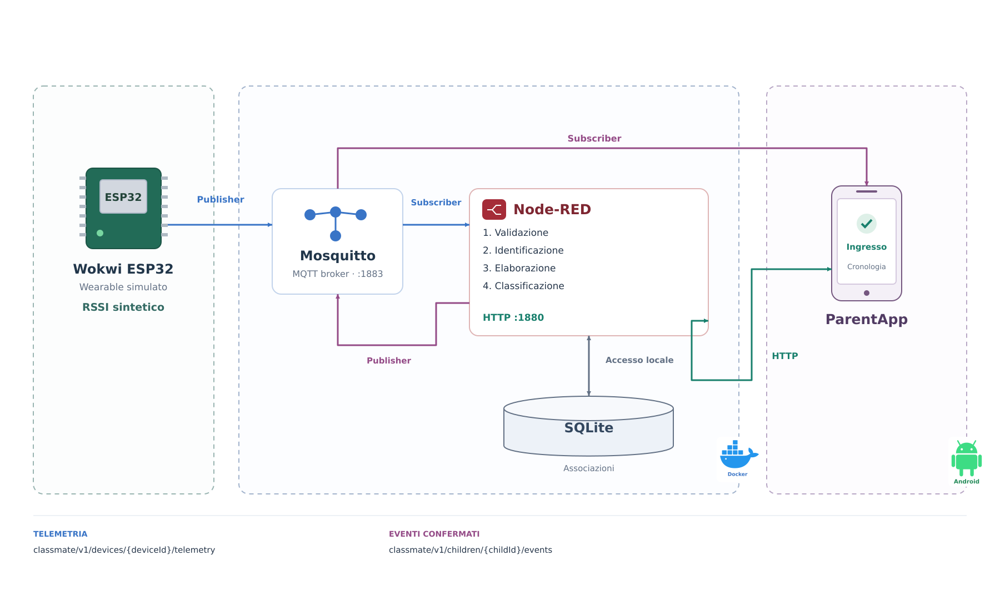
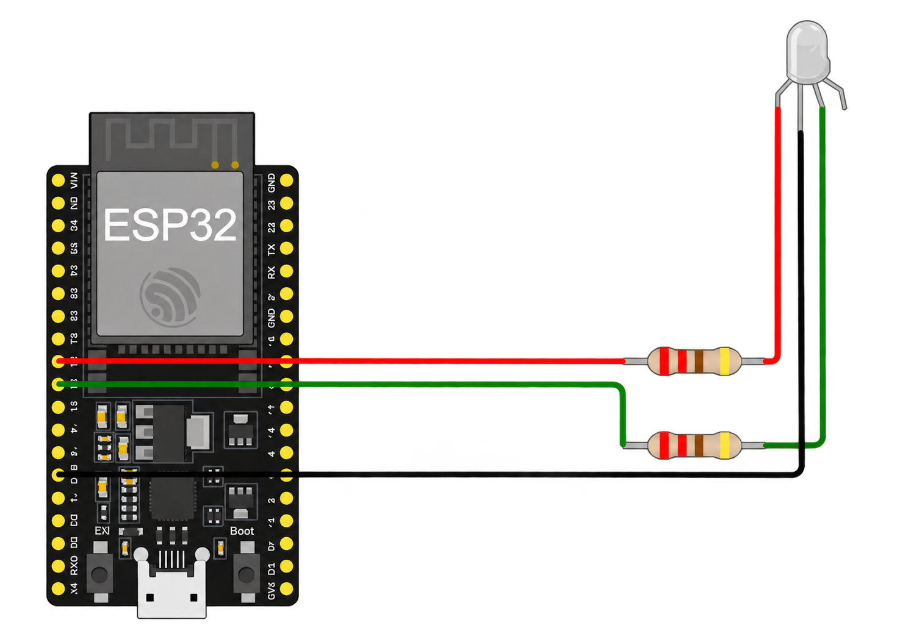
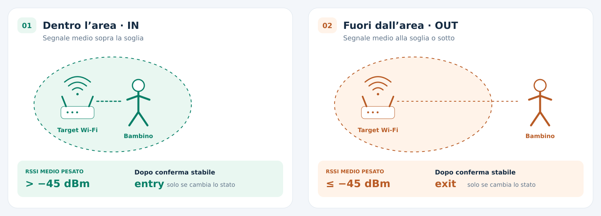

<picture>
  
</picture>

# 🎒ClassMate

ClassMate è una PoC per rilevare l'ingresso e l'uscita dei bambini da scuola tramite un dispositivo IoT indossabile.
Il dispositivo simulato invia dati di prossimità al sistema, che li elabora per registrare gli eventi di presenza.
I genitori possono consultare lo stato e la cronologia degli eventi nell'app Andoid "ParentApp", per sapere quando il bambino entra o esce.

## 🚀 Quick Start

Prerequisiti: Docker Compose, PlatformIO, VS Code con estensione Wokwi e Android Studio. Eseguire i comandi dalla radice di questo repository; `ParentApp` si trova nel repository Android separato, sul branch `iot`.

1. **Configurare host e credenziali.** Impostare l'IPv4 LAN del PC in `POC_BIND_ADDRESS` (`infra/config/defaults.env`) e in `mqttHost` (`firmware/include/wokwi_config.h`). Creare i tre file di password MQTT a partire dagli `.example` in `infra/secrets/`, sostituendo i contenuti con password distinte. Copiare `firmware/include/secrets.example.h` in `firmware/include/secrets.h` e impostare `device_secrets::mqttPassword` alla stessa password di `infra/secrets/mqtt_wearable_password`. 

2. **Avviare Compose e inizializzare il database.** Il provisioning usa `database/poc.example.json` (codice genitore dimostrativo `abcd`) e va eseguito su un database vuoto:

   ```sh
   ./infra/scripts/up.sh
   ./infra/scripts/database.sh provision
   ```

3. **Selezionare il profilo e compilare il wearable.** Impostare `syntheticProfile` in `firmware/include/wokwi_config.h` (predefinito `entry-exit`; [profili disponibili](#wokwi-esp32)), quindi:

   ```sh
   cd firmware
   pio run -e wokwi
   ```

Aprire la cartella `firmware/` in VS Code e avviare la simulazione Wokwi con il Private IoT Gateway attivo, così l'ESP32 su `Wokwi-GUEST` raggiunge il broker MQTT del PC. Dopo un cambio di profilo, ricompilare e riavviare la simulazione.

1. **Avviare ParentApp su Android.** Nel repository Android separato aprire `ParentApp` in Android Studio. Nelle proprietà Gradle **utente** (`~/.gradle/gradle.properties`, non nel repository) impostare `pocHost` all'IPv4 LAN del PC, `pocMqttUsername=parent-poc` e `pocMqttPassword` alla password di `infra/secrets/mqtt_parent_password`. Compilare e avviare l'app su dispositivo o emulatore, poi loggarsi con il codice del seed (`parent`).

**Nota:** PC con Compose, simulatore Wokwi tramite Private IoT Gateway e dispositivo Android devono potersi raggiungere sulla stessa LAN fidata.

## Architettura



Il flusso parte dal wearable simulato e arriva all'app dei genitori attraverso il broker MQTT. Ogni componente ha un ruolo distinto:

- **Wokwi ESP32 (`firmware/`)**: simula il dispositivo indossabile, produce campioni RSSI sintetici e pubblica la telemetria MQTT del proprio dispositivo.
- **Mosquitto (`infra/`)**: è il broker MQTT; riceve la telemetria dall'ESP32 e la consegna a Node-RED, poi distribuisce gli eventi confermati a ParentApp. Le ACL limitano pubblicazione e sottoscrizione ai topic consentiti.
- **Node-RED (`nodered/`)**: si sottoscrive alla telemetria, valida i messaggi, verifica l'associazione dispositivo-bambino e scarta sequenze duplicate. Calcola una media RSSI pesata, classifica la presenza e conferma le transizioni stabili; salva i nuovi eventi con l'outbox e li pubblica via MQTT con retry. Espone inoltre le API HTTP per codice genitore, elenco bambini e cronologia.
- **SQLite (`database/`)**: conserva associazioni, stato dei dispositivi, eventi di ingresso/uscita e outbox per la pubblicazione affidabile. La cronologia è letta dalle API di Node-RED.
- **ParentApp**: risolve il codice genitore e consulta la cronologia tramite HTTP; si sottoscrive via MQTT agli eventi del bambino selezionato per mostrare lo stato corrente, senza pubblicare messaggi.


## Wokwi ESP32

L'ESP32 simulato in Wokwi rappresenta il dispositivo indossabile: genera campioni RSSI sintetici e, come **publisher MQTT**, invia la telemetria al broker Mosquitto. Il firmware è scritto in C++ con PlatformIO; la connessione Wi-Fi `Wokwi-GUEST` usa Wokwi Private IoT Gateway per raggiungere il broker sul PC.



Per scegliere uno scenario, modificare `syntheticProfile` in `firmware/include/wokwi_config.h`, compilare con `pio run -e wokwi` dalla cartella `firmware/` e riavviare la simulazione. Il firmware genera un campione ogni secondo: per cambiare l'intervallo, modificare `SampleSchedule::periodMs` (in millisecondi, predefinito `1000`) in `firmware/include/sample_schedule.h`, poi ricompilare e riavviare la simulazione. I profili disponibili sono:

| Profilo | Campioni / comportamento |
| --- | --- |
| `outside` | `-90, -88, -91, -89` dBm in ciclo; segnale debole |
| `inside` | `-42, -40, -43, -41` dBm in ciclo; tutti sopra la soglia |
| `entry-exit` (predefinito) | 30 campioni `inside`, poi 30 `outside`, in ciclo (circa 30 s per fase, prima del filtro) |
| `target-not-observed` | `targetObserved:false` e `rssiDbm:null` a ogni intervallo; il mancato rilevamento non genera un'uscita |
| `interruption` | Tre campioni a `-55` dBm, poi nessuna pubblicazione e LED rosso; il silenzio non genera un'uscita |

Per esempio, sul topic `classmate/v1/devices/esp32-001/telemetry` pubblica un payload JSON come questo (il `bootId` e l'uptime variano a ogni esecuzione):

```json
{"schemaVersion":1,"deviceId":"esp32-001","bootId":"8b210baef3b139ac","sequence":2,"deviceUptimeMs":12805,"wifi":{"targetObserved":true,"rssiDbm":-91}}
```

## MQTT broker

Il broker è **Eclipse Mosquitto**, avviato come servizio `mosquitto` da `infra/compose.yaml` tramite `./infra/scripts/up.sh`. Ascolta sulla porta `1883` del container; Compose la espone solo sull'IPv4 LAN configurato in `POC_BIND_ADDRESS` (`infra/config/defaults.env`). L'ESP32 simulato lo raggiunge tramite Wokwi Private IoT Gateway e l'indirizzo `mqttHost` in `firmware/include/wokwi_config.h`; Node-RED usa invece il nome di servizio `mosquitto` sulla rete Compose. I messaggi sono JSON UTF-8 con `schemaVersion: 1` e QoS 1.

La configurazione in `infra/mosquitto/mosquitto.conf` abilita la persistenza dei messaggi retained nel volume `mosquitto-data`, disabilita l'accesso anonimo e limita il QoS massimo a 1. Le password delle tre utenze provengono dai file `infra/secrets/mqtt_*_password` (da creare a partire dagli `.example`): all'avvio `infra/mosquitto/mosquitto-entrypoint.sh` genera solo il file delle password. Mosquitto legge direttamente le regole statiche in `infra/mosquitto/acl.conf`, incluse quelle per `esp32-001`. I nomi delle utenze sono in `infra/config/defaults.env`: se si cambia quello del wearable, aggiornare anche `deviceId` nel firmware e la relativa regola in `acl.conf`.

| Topic | Pubblica | Sottoscrive | Retained | Contenuto |
| --- | --- | --- | --- | --- |
| `classmate/v1/devices/{deviceId}/telemetry` | ESP32 | Node-RED (`classmate/v1/devices/+/telemetry`) | No | osservazione `rssi wifi` |
| `classmate/v1/children/{childId}/events` | Node-RED | ParentApp | Sì, ultimo evento per bambino | classificazione `type` (`entry`/`exit`) |


## Node-RED

### core workflow

Node-RED riceve i dati inviati dal dispositivo e li trasforma in eventi di ingresso o uscita attraverso quattro passaggi:

1. **Validazione.** Controlla che i dati ricevuti siano corretti e utilizzabili, scartando quelli incompleti o non attendibili.
2. **Identificazione.** Verifica a quale bambino è associato il dispositivo ed evita di elaborare rilevazioni già ricevute.
3. **Elaborazione.** Calcola la media delle ultime rilevazioni del segnale, dando più importanza a quelle recenti. Così una singola variazione improvvisa influisce meno sul risultato.
4. **Classificazione.** Stabilisce se il bambino è dentro o fuori dalla scuola e registra un evento solo quando il cambiamento è confermato, rendendolo disponibile all'app dei genitori.

### media pesata

I parametri si configurano in `infra/config/defaults.env` e vengono passati a Node-RED da Compose:

| Parametro | Default | Effetto |
| --- | --- | --- |
| `RSSI_WINDOW_SIZE` | `10` | Numero di campioni nella finestra per dispositivo |
| `RSSI_THRESHOLD` | `-45` dBm | Confine fra `IN` e `OUT` |
| `RSSI_STABILITY_COUNT` | `3` | Numero di ripetizioni consecutive del candidato dopo la prima valutazione |

Nella finestra completa di `N` valori, ordinati dal più vecchio al più recente, il campione in posizione `i` (a partire da `1`) riceve peso `i`:

```text
RSSI_pesato = (1·RSSI₁ + 2·RSSI₂ + … + N·RSSIₙ) / (N·(N+1)/2)
```




## SQLite 

`database/schema.sql` abilita i vincoli di associazione e l'accesso dati usa foreign key e WAL:

| Tabella | Contenuto |
| --- | --- |
| `parents`, `children`, `parent_child` | Codici, bambini e associazioni attive |
| `devices` | Assegnazione attiva uno-a-uno fra dispositivo e bambino |
| `device_state` | Ultimo boot, sequenza e ricezione accettati |
| `attendance_events` | `event_id`, `child_id`, `device_id`, `type`, `received_at`, `weighted_rssi` |
| `event_outbox` | Topic, payload e stato dei retry MQTT |

Lo stato corrente deriva dall'ultimo evento canonico del bambino: prima del primo evento è sconosciuto, non `OUT`. Non esistono `presence_state`, `occurred_at` o `evidence_json` nello schema. Cronologia ordinata per `received_at DESC, rowid DESC` e paginata con cursore opaco. SQLite non espone porte TCP.

Esempi API Node-RED, con il codice del seed dimostrativo:

```sh
curl -sS -X POST -H 'Content-Type: application/json' \
  -d '{"code":"parent"}' http://192.168.1.49:1880/api/v1/parents/resolve
curl -sS -H 'x-parent-code: parent' http://192.168.1.49:1880/api/v1/children
curl -sS -H 'x-parent-code: parent' \
  'http://192.168.1.49:1880/api/v1/children/child-001/events?limit=20'
```

| Metodo e percorso | Richiesta | Risposta |
| --- | --- | --- |
| `GET /healthz` | Nessuna | `200` con `status`, `service`, `database`; `503` se il database non è sano |
| `POST /api/v1/parents/resolve` | JSON `{ "code": "..." }` | Genitore con `children`, oppure `404` `not_found` |
| `GET /api/v1/children` | Header `x-parent-code` | `{ "children": [...] }` |
| `GET /api/v1/children/:childId/events` | Header `x-parent-code`, query `limit` (default 20, massimo 100), `cursor` opzionale | `{ "events": [...], "nextCursor": null | "..." }` oppure `404` se non associato |

Gli eventi HTTP contengono `eventId`, `childId`, `deviceId`, `type`, `receivedAt`, `weightedRssi`. Usare `nextCursor` senza interpretarlo. L'accesso tramite codice **non è una password né un'autorizzazione robusta**; chi conosce il codice può leggere i dati associati nel POC.

